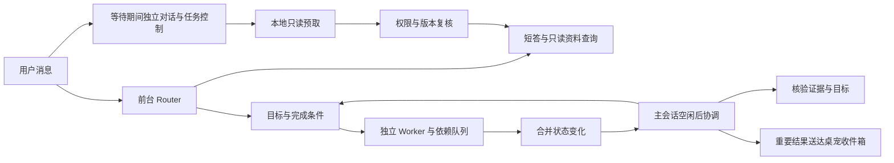

# Router 协调、链式召回与前台并行

版本：0.3.8-preview.80；内置运行环境：0.3.84-whale-coordinator。

此前的后台 Worker 能独立执行，单条回执默认静默，前台也可能自己执行长任务。资料工具支持搜索和按版本读取，但没有自动追查关联来源的入口。因此不能把此前版本称为完整的全双工 Agent。

本次将前台短答、后台执行和协调汇报接到同一条流程。目标是在后台工作期间继续交谈，并在重要变化出现时主动交付整体结果。

## Router 承担的工作

- `mobile_coordinator status` 聚合本会话的工单、进度、依赖、阻塞和目标，每页最多 32 项；全局指纹覆盖全部工单。
- 状态变化合并处理，主会话繁忙或已有排队输入时不插队。普通进度约 30 秒合并，终态和受阻变化约 3 秒合并，实际投递还受调度节拍及前台状态影响。
- 原有 priority、add、reply、resume、cancel 和依赖机制继续负责调度，协调者检查后使用这些入口；不自动扩大权限或预算。
- `report` 必须带最新指纹，旧状态不能确认新结果。只有重要结果、关键受阻和需要用户回答时 `notify=true`，通过持久收件箱送达桌宠；普通进度仅记账。
- 相同阻塞不会因为另一项任务的普通进度重复推送。尚未送达的重要汇报独立保留，后续内部进度不会覆盖它。
- 投递不等于处理。未记录协调结论时保留未确认状态，最多两次同指纹唤醒，避免模型异常导致无限调用。损坏的协调索引暂停唤醒；`reconcile` 可从工单权威状态重建索引，不重放 Worker 动作。
- 工单全部自报完成后仍需 `mobile_goals verify`，汇报不能冒充目标验收。
- 创建时的 `maxTokens`、`maxCalls`、`maxMinutes` 先校验，再随来源事件持久化并传到 Worker。实测定位并修复了此前创建链路丢失这些参数、仍用默认预算的问题。

## 前台并行的范围

手机操作统一交给 device Worker，前台拒绝直接操控及长时间等待工具。设备执行仍互斥，聊天和只读后台工作可以并行。

纯界面任务可用 `toolProfile=screen`，模型目录与执行白名单均收窄到 10 个必要工具；需要文件或 shell 的任务保留完整设备模式。预算包含每轮重复输入和缓存命中 token，因此缩短工具上下文比单纯扩大预算更有价值。

桌宠原请求尚在等待时，新消息由独立接取线程判断。完整独立的聊天或简短资料问题走没有动作工具的回复通道，答案先显示、单独落盘，随后按原有成对历史规则归档。需要原任务结果的更正和追加保留顺序。查询与明确取消后台任务有单独控制入口；多目标有歧义时不猜测取消对象。

切换话题、关闭服务和取消等待会失效对应的在途接取；并行回答不改写正在执行的 Harness 请求，也不会把原动作再次提交。前台模型自身仍需要网络响应时间；本次不是无限并发的模型通道。

独立回复通道当前接在原生桌宠窗口。App 的 Harness 对话依靠 Router 快速交办、后台 Worker 独立执行和禁止前台长等待来保持可用，仍未改成可抢占当前模型生成的多路流式会话；语音边听边说也不在本次范围内。

## 链式召回与投机执行

`mobile_context_recall` 与桌宠简短资料查询共用有界召回：关键词候选 → 已确认记忆的原始资料 → 相邻文档片段或原件记录。最多两跳、十个节点，每个节点最多 1,200 字，返回 ID、版本、关系路径、片段位置和解析覆盖信息。来源删除、版本改变或不可用时记录缺口；不把旧记忆当成当前原文。

前台判断意图时并行准备一个本地只读候选。仅当问题需要资料，且权限、命中集合和每个节点版本仍一致时消费；否则丢弃或重新查询。候选最多保留 30 秒，线程与队列有界，未采用的预测不调用额外模型，也不执行手机动作、发送、写资料或发布操作。

这属于可取消的只读预取。尚不包含基于实体图谱的任意语义多跳、多个推理分支竞速、带副作用动作的投机提交/回滚，也没有接管持续主动思考模块的全部检索路径。

## 与公开 Super Agent 原型的对应

参考固定版本 [执行设计](https://github.com/deepseek-ai/dsh-superagent-prototype/blob/8c32a9dc5d72c033816c6a8110b37f40cf94fba4/docs/003-execution.md) 和 [会话实现](https://github.com/deepseek-ai/dsh-superagent-prototype/blob/8c32a9dc5d72c033816c6a8110b37f40cf94fba4/src/app/sessions.ts)：前台调度、执行侧独立工作、回报唤醒及限制前台等待是明确可对照的实现。本次沿此方向补齐手机项目的协调与交互接线。

该固定版本公开源码未明确给出本项目所说的通用链式召回或投机执行成套机制，不能把这些名词当作已经照搬实现的证明。跨渠道真实续接仍按用户要求留待另行安排。

## 验证

结果见 [Pocket S 验收](PocketS全双工与协调验收-20261106.md) 和本版发布说明。自动化夹具的并发、失效和恢复检查，与真实模型/真实 Worker 的并行执行分别记录。
