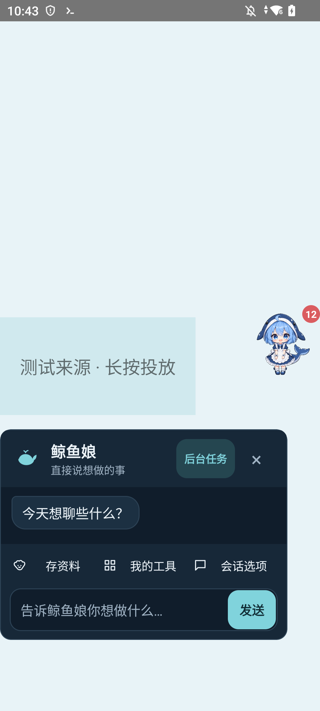
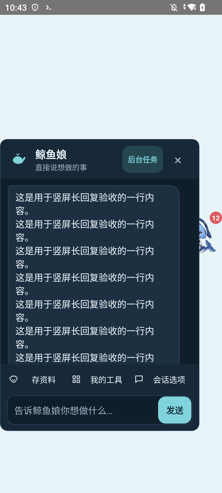
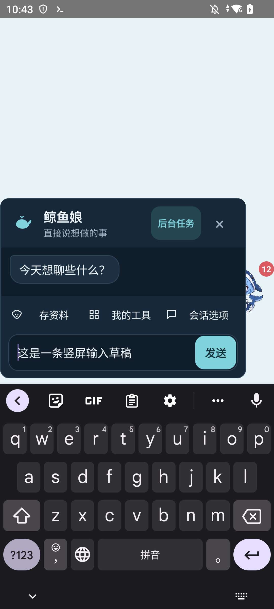
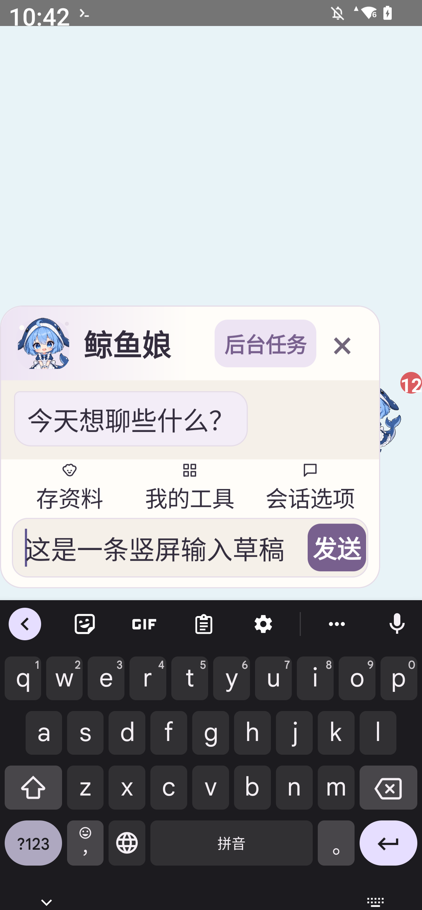

# 鲸鱼助手 0.3.8-preview.73

针对竖屏手机重新调整桌宠自动高度，并包含 preview.72 的 App / 桌宠动效及工单容灾改进。

## 竖屏桌宠

- 短消息保持紧凑，长回复按内容增长，在约六成可用高度内滚动；通常不超过 480dp。
- 键盘与展开选项共同占用空间时，优先保留输入框和消息区，菜单使用剩余空间滚动。
- 修正状态栏坐标偏移，覆盖桌宠在顶部、中部和底部的定位；键盘收起后重新恢复原高度。
- 大字号竖屏的三个快捷按钮改成图标在上、文字在下，避免完整名称被挤成两行。
- 手动低 / 高模式与内嵌工具继续可用，两套主题的浅色、深色外观均覆盖。

## 本轮验证

Pocket S 手机视口：390dp × 840dp、普通 / 1.6 倍字号，以及 360dp × 800dp、普通字号。四种主题与上中下三个桌宠位置，共 36 组短消息、长消息和真实键盘检查通过。正常输入、展开选项与收起键盘均检查实际输入区边界。已查看短消息、键盘和大字号截图。

最终版大字号快捷按钮通过可见性与单行文字检查。横屏 / 大字号竖屏各 12 组内嵌工具与真实键盘回归也通过。荣耀当前未连接，本版没有声称已在荣耀安装验收。

前端 1,155 项通过；脚本 477 项中 473 项通过、4 项跳过；Android 单元共 1,847 项，失败 / 错误为 0，37 项跳过。运行环境继续使用 0.3.72-whale-resilience，SHA-256 为 f4dd5b568e9393c2e284f1a6859025adf8aedafc618d6bb340eb565aa9aced15。

动效设计与覆盖见 [App与桌宠动效设计](App与桌宠动效设计-20261106.md)，存储损坏隔离及真实工单续接见 [异常模拟与容灾设计](异常模拟与容灾设计-20261106.md)。SQLite 事务迁移、整机重启 / 长时 Doze / 实际整盘写满，以及真实跨渠道链路仍待独立验收。

## 最终设备记录

- 真实配色与高度组合：phone390-palette 25.043 秒、phone390-font16-palette 24.028 秒、phone360-palette 24.528 秒，均通过，日志位于 build/p73-device-*.log。
- 工具回归：横屏 11.956 秒、390dp 竖屏 1.6 倍字号 9.981 秒，计算器、结果带回和键盘高度恢复通过。
- 15 次切页首次采样 275 帧、7 个超时帧、P95 32 ms；预热后 249 帧、2 个超时帧（0.80%）、P95 18 ms。关闭动画后 58 帧、1 个超时帧、P95 16 ms。关闭动画会减少采样帧数，不能据此计算优化百分比；首次页面加载的长帧仍需继续优化。
- Pocket S 安装包 SHA-256：F1A3CB6668CCD71B883E7B6CC58F44319603A10DE85084C53C7A7FA18449744F。
- 本轮结束恢复原来的物理分辨率、1.0 倍字号、动画设置及无障碍服务条件。未修改或删除用户资料和历史失联工单。

## 竖屏画面

截图来自 Pocket S 的手机尺寸区域和隔离测试文案。

短消息：

长回复：

键盘与大字号：

