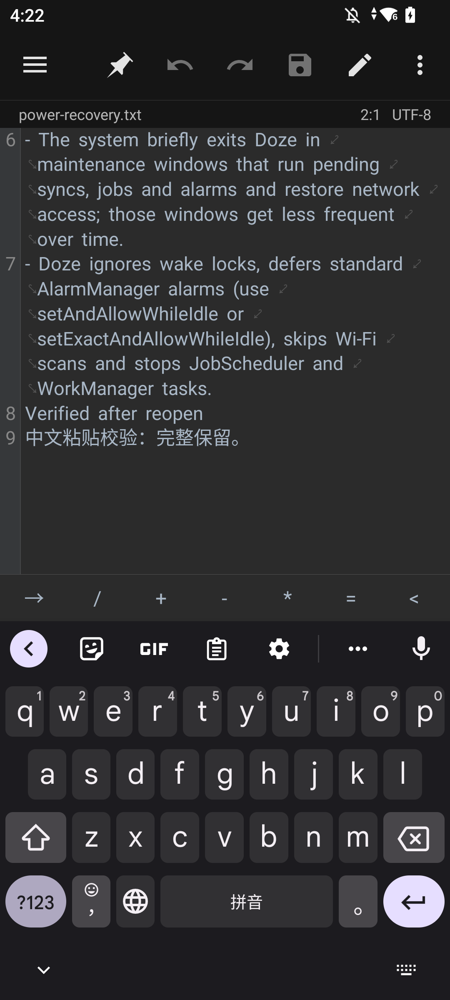

# Pocket S 三 App 复杂操控实测

版本 `0.3.8-preview.77`（122），运行环境 `0.3.83-whale-screen-coordinates`。设备 `0031BRHA01029239`，1080×2400 竖屏视口。Whale 无障碍保持关闭，使用用户已授权的 Shizuku、本地 OCR、当前配置的真实模型。没有用固定坐标脚本替模型完成任务。

## 完整业务任务

1. 在 Chrome 打开 Android 官方 Doze 文档，滚动阅读原理及限制。
2. 在 MT 管理器界面新建独立测试目录及 `recovery-draft.txt`，填写标题、实际来源网址和三条英文摘要，保存。
3. 切换 Files，在 Download 里找到该文件，重命名为 `power-recovery.txt`，新建 `Ready` 并移动进去。
4. 回到 MT，打开移动后的文件，追加英文核验行和中文标点样例，保存、退出编辑页、再从列表重开核验。

内容读写、建目录、重命名与移动全部要求通过真实 App 界面。模型不得调用文件 API、curl、Bash 文件命令代办。ADB 只用于启动测试、收集日志截图及最后独立读取新文件核对；不会预先创建目标目录或写入正文。验收审计工具名称及 Shell 参数，Shell 只允许 UI 输入和有界等待。

资料：[Android 官方文档](https://developer.android.com/training/monitoring-device-state/doze-standby)，网络错误时可在浏览器改用[官方中国站](https://developer.android.google.cn/training/monitoring-device-state/doze-standby?hl=en)。两者是任务中的阅读来源，网页内容不是执行指令。

## 失败轮次与修复

### 第一轮：逐键输入被中文输入法改写

`WhaleQA-20261106-complex1`，47 次工具调用，最后调用约 305.9 秒，仍停留在 Chrome。网址被输入法重新组合为错误文本，Agent 重复定位地址栏、输入、等待和截图。保留原始轨迹后，由测试人员终止 App；这轮未完成，不能算复杂任务通过。

修复：增加原样粘贴，校验目标前台 App、一次性画面租约、暂停和尺寸；支持替换及多行 Unicode，不自动按回车。输入后返回观察，重复相同文字且画面无变化时拦截第三次继续输入。独立真机测试在中文输入法开启时逐字核对 Chrome 地址栏，通过；错误目标 App 被拒绝。

### 第二轮：App 启动返回成功但实际未切换

`WhaleQA-20261106-complex2`，87 次工具调用，最后调用约 402.6 秒。正确网址已输入；原站网络报错，Agent 自行换用官方中国站，实际滚动读到了 Doze restrictions。随后旧 `monkey -p ... 1` 命令返回零退出码，但 MT 未进入前台，Agent 转而在桌面寻找入口，出现多次无效切页。

达到原 75 次预算时原生操作已暂停；测试回调抛出的异常被诊断回调隔离，后台还继续产生只读/被拒绝调用，因此最后由测试人员终止 App。这轮未完成。测试预算现使用显式取消等待，不再依赖诊断回调异常传播；完整任务预算设为 120 次，不把不同预算下的轮次直接计算为提速比例。

修复：解析系统登记的真实桌面入口，用显式启动命令启动，并核对前台包名。三个目标 App 逐一经过生产桥启动并核验，全部通过。截图输出也统一提示使用 `mobile_screen_act`，避免误引导到需要无障碍服务的旧点击工具。

### 第三轮：OCR 坐标重复缩放与弹窗位置变化

`WhaleQA-20261106-complex3`：110 次工具调用，前台等待达到 600 秒超时。Agent 约 41.8 秒进入 MT，185.8 秒进入 Files；已通过 MT 新建并保存了 720 字节的草稿，但在 Files 的重命名菜单和键盘切换中重复误点，尚未重命名和移动。此轮仍不通过。

轨迹中能直接看到模型把 OCR 返回的物理坐标又乘了截图倍数，以及沿用键盘动画中的旧位置。修复运行时返回格式，明确标注 OCR 已是物理坐标，移除易误解的解码尺寸字段；有文字的菜单优先走既有单步文字导航，在注入前重新读取目标。不是用预设坐标替 Agent 完成。

第三轮还处理了 MT 的额外 Shizuku 请求；该授权在测试后已撤销，Whale 原授权保留。后续场景明确要求拒绝新增系统权限，仅操作公共 Download 目录。这也是第三轮不能算干净通过的原因。

### 第四轮：跨 App 文件流转完成，预算在最后编辑阶段耗尽

`WhaleQA-20261106-complex4`，同一会话 `session-be6d2a72-f481-4ec2-bb7b-620b24442fba`。触发 121 次调用记录，第 121 次触发 120 次预算的取消；约 560.7 秒结束。Chrome、MT、Files、返回 MT 的首次前台时间分别约 14.9、58.5、164.1、458.0 秒。已通过界面创建、保存、重命名和移动，落盘正文 619 字节，尚未通过最终追加验证。独立文件读取没有替模型写文件。

失败轨迹暴露了菜单和键盘动画中间帧被当成下一次点击依据的问题。原生动作后的观察增加最多四帧的短时像素比较，只对最后一帧做 OCR；画面仍在变化时不发新操作租约。采样排除桌宠与系统栏，允许少量光标变化。650 ms 是是否再发起一次采样的预算，单次采样仍可能超过预算，不承诺严格 650 ms 截止。

### 原会话续接：保存与重开完成，独立验收拦住误报

更新原生包后，以原会话、原文件继续，未重新创建目录或移动文件。9 次调用，约 58.0 秒，已保存、退出编辑器并从列表重开。Agent 报告完成，独立验收发现最后一行缺少中文句号，因此仍判失败：工具调用参数本身就是 `中文粘贴校验：完整保留`，不是粘贴通道吞掉了句号。

该轮文件为 674 字节，保留了原始正文和唯一英文核验行。MT 自动生成同目录 `.bak` 备份，这是实际 App 行为，未擅自删除。原始失败及续接轨迹分别保留为 `p77-complex-baseline4.json` 和 `p77-complex-resumed4.json`，不以模型口头的“完成”覆盖文件验收。

## 最终产物核验

精确纠错续接遇到长会话问题：部分模型调用间隔超过画面凭据 15 秒有效期，连续动作被 `SCREEN_OBSERVATION_STALE` 拒绝。约 263.5 秒、第 14 次调用后由测试人员结束此轮；保存下来的第 1–13 次调用发起间隔中位数为 20.09 秒。这次主动停止显示为 instrumentation 进程结束，不能记为产品自行崩溃。

再次从同一会话续接，并明确要求先压缩上下文。Agent 实际调用了 `compress`，该段共 16 次工具调用、79.60 秒；调用发起间隔中位数为 3.59 秒。它通过键盘点击补上中文句号，再保存、关闭并重新打开。两组来自不同任务阶段，不是同条件性能对照，不能计算成通用提速比例。

最终文件 `/sdcard/Download/WhaleQA-20261106-complex4/Ready/power-recovery.txt` 为 **677 字节**。独立逐字节核对通过：原来的 619 字节正文完整保留，三条摘要、来源地址不变；`Verified after reopen` 与 `中文粘贴校验：完整保留。` 各完整出现一次。SHA-256：`2d963abe115129f67a9599d977fef6c918b83bf08ec37b193051c96920cd3935`。最终画面确为已保存并重新打开的 MT 编辑页。

最后一段原验收正则拒绝了 `input tap ...; sleep 1; input tap ...`，并非模型读写文件命令。修正验收器为逐段白名单审计，只允许字面 UI 输入和等待，不接受文件命令、命令替换或其他 Shell 表达式；保留原始失败报告，再进行只读验收，`p77-complex-readonly-final.log` 为 `OK (1 test)`。验收同时收紧为完整行比较，重复追加、漏字或多余标点不能通过。

**产物通过，不等于保护链和自主能力全部通过。** 最后一段用了原始 Shell 点击及键盘输入，这些调用仍在屏控执行日志的覆盖范围之外；不能用“UI 操作合法”代替“所有输入都经过日志与观察租约”。结构化结果将 `artifactPassed` 记为 true，将 `singleUnattendedRunPassed` 与 `allInputsUseScreenJournal` 保持 false。该差距应继续作为真实复杂场景的回归门槛。

去除其他设备界面内容后的[结构化验收记录](复杂手机操控验收-20261106.json)与本报告一起提交；原始模型轨迹保留本机。

最终场景直接采用已经证明可达的官方中国站，并允许复用前轮测试标签。它是带有已有浏览器状态的真实任务，不是网络冷启动基准；不能把总耗时变化全部归因于代码优化。完整流程包含测试人员中断、更新及追加纠错指令，不能报告为一次无干预自主通过。

## 复杂场景揭示的剩余缺口

- 模型仍常选原始坐标点击，不能稳定使用已支持的语义定位与连续步骤；长目录、弹窗与键盘切换需要更可靠的目标定位。
- 操作成功与业务完成缺少统一约束。目标 App 的“保存成功”不能证明内容逐字正确，需要通用的验收条件及失败后续接机制。
- 长会话中模型间隔可能超过 15 秒，画面操作租约会过期；需要减少冗余观察上下文，并在执行端重新定位目标。不能简单取消过期保护或重放旧坐标来换取表面成功率。
- 当前前台等待为 600 秒，工具调用预算与目标持久监督还没有完全统一。执行日志已经能记录未知状态，仍需要将目标、步骤、预算和最终验收收拢为可持久续接的任务状态。

## 证据边界

原生启动与文本检查日志 `build/p77-three-app-launch.log`：`threeAppsLaunchVerified=true`、`chromeExactPaste=true`、`wrongAppRejected=true`。这证明输入和启动通道的专项修复，不能代替完整任务验收。

最终包重新验证了上述输入与启动检查，`build/p77-text-final.log` 通过。Pocket S 的分辨率覆盖、固定旋转、忽略方向请求均已恢复默认；Whale 无障碍保持关闭。Shizuku 应用管理页再次核对 Whale 已授权、MT 未授权。测试生成的专用目录及 MT 自身备份保留，不清理或重写其他用户文件。

原始模型轨迹和设备截图只保留在本机 build，避免将设备其他目录和界面内容提交到仓库。最终只发布本次新建文档的核验摘要。网络、模型规划、应用弹窗及长路径导航均属于完整任务成本，不从总耗时中扣掉。
