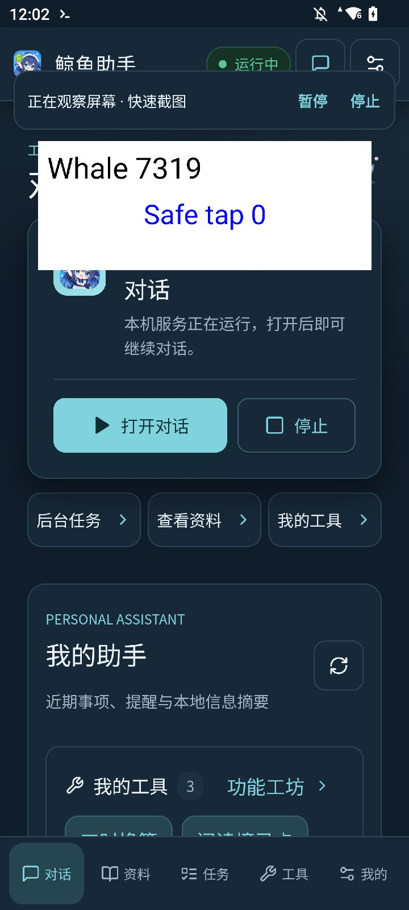

# 屏幕控制提速对照与实测

日期：2026-11-06。范围：主屏观察、视觉截图、输入注入与动作后回看。Pocket S 实际执行；荣耀本轮未连接。

## 源码参考与取舍

| 项目 | 参考机制 | 本项目落地 |
| --- | --- | --- |
| [DSH Go](https://github.com/ccch1mneyyy/dsh-Go/tree/915a3f437e227ee640d71d902c0472273d2dca62) | 原生截图与节点、动作后返回新快照、依据界面事件等待、旧节点验证 | 原生树优先；按需原始像素、合并动作与观察、一次性观察编号 |
| [scrcpy 开发文档](https://github.com/Genymobile/scrcpy/blob/master/doc/develop.md) | 常驻服务、独立输入与媒体通道、进程内 InputManager 注入 | 复用已授权 Shizuku 进程，主屏独立注入器，截图管道不走终端 |
| [AOSP Android 13 screencap](https://android.googlesource.com/platform/frameworks/base/+/android-13.0.0_r1/cmds/screencap/screencap.cpp) | 原始帧的宽、高、格式、色彩空间头和紧密排列像素 | Android 10+ 校验 16 字节原生序帧头，限尺寸、限像素、逐行读取；不支持时兼容 PNG |

DSH Go 源码定位：ScreenShooter.kt、MainScreenDriver.kt、Actuator.kt、EventClock.kt，位于 app/android/app/src/main/kotlin/io/github/ccch1mneyyy/dsh_app/phone/a11y/。本次参考提交固定为 915a3f437e227ee640d71d902c0472273d2dca62。其 AGPL 授权实现没有被复制进本项目；这里按 Android 系统接口独立实现。

没有安装竞品后做速度对比，因此不宣称比 DSH Go 或 scrcpy 更快。无障碍服务关闭时，Whale 的新截图仍每次启动原生 screencap，尚未接入零拷贝 HardwareBuffer 主屏后端。新动作后的 80 ms 渲染机会是有界等待，不等同于 DSH Go 的界面事件稳定检测。

## 改前瓶颈

测量文件 build/p74-device-latency-baseline.log，安装版本 preview.73，5 轮，同一 1000×340 像素白色浮层。浮层显示 Whale 7319 与 Safe tap 数字按钮，通过真实触摸更新计数。

| 阶段 | 5 次耗时，ms | 中位数 |
| --- | --- | ---: |
| PNG 截图 | 1495、638、451、694、579 | 638 |
| 已取得截图的单独 OCR | 230、87、79、91、87 | 87 |
| 完整区域观察 | 495、829、587、633、609 | 609 |
| Shell 点击到控件收到输入 | 100、98、96、92、92 | 96 |

各阶段独立采样，不是同一截图的组成加和。冷启动、机器负载会影响首项和离散程度。

## 新链路

1. 原生节点可用：直接返回控件树；不默认追加 OCR。
2. 需要 OCR：Shizuku 原始像素 → 有界管道 → 区域裁剪 / 最长边 1600 采样 → 本地 OCR → 反算物理坐标。没有 PNG 或终端 Base64。
3. 需要视觉模型：同一原始帧入口 → 1600 像素以内 JPEG → 附件服务。即使附件再次缩放，也按物理原图尺寸计算比例。
4. 动作：最新观察编号 → 既有原生授权或已开启 AI Shell 的常驻 Shizuku 注入 → 80 ms 渲染机会 → 新观察。
5. 一个执行世代覆盖动作与观察；暂停 / 停止先撤销世代，再异步取消输入和采集，旧回合不能开始后续步骤。

主屏注入与副屏注入是独立实现。副屏原先的 displayId > 0 限制保留。新主屏工具只支持 tap / swipe / back，没有任意 Shell 脚本参数。滑动限 80–1000 ms；不会在一半动作失败后切换输入通道。

观察编号仅约束重复、超时和本机执行顺序，不能证明第三方 App 在模型思考期间没有自发变化。动作返回 injected=true 仅表示系统接受输入；必须从新观察核实业务结果。输入完成但回看失败时返回动作回执与 observationError，不能直接重放。

## 首轮原生实测

日志 build/p74-device-screen-final.log，Pocket S 2560×1440 横屏，Shizuku 已授权、AI Shell 已开启，Whale 无障碍服务关闭。4 项测试，34.564 秒通过。

| 阶段 | 5 次耗时，ms | 中位数 |
| --- | --- | ---: |
| 同版本旧 PNG | 555、663、456、571、497 | 555 |
| 新视觉 JPEG | 228、212、205、214、205 | 212 |
| 原始帧区域观察 | 221、203、186、200、180 | 200 |
| 常驻点击注入 | 3、2、2、2、1 | 2 |
| 点击 + 等待 + 新 OCR | 311、281、295、273、284 | 284 |

原始帧采集 156–165 ms、区域 OCR 20–54 ms。JPEG 字节中位数 93,504，PNG 中位数 373,986。JPEG 以真实 MIME 和原始屏幕尺寸返回，已解码并查看实际缩略图，验收按钮和状态条可读。

计时口径：Shell 点击包含桥调用到控件到达检查；常驻 injectionMs 只计服务内部注入，不能直接据此计算速度倍数。整体交互应参考 actionAndObserveMs。

真实触摸：性能测试旧 Shell 5 次、新常驻 5 次；原控制测试 2 次，共 12 次。每轮合并动作的 OCR 都读到了新计数。首次测试对 OCR 空格格式要求过严失败；改成只忽略空白后重新验证，未降低数字与真实计数要求。

异常检查：

- 重复 observationId 被拒绝，无额外点击。
- 暂停后、恢复前拒绝操作；恢复后旧观察仍失效。
- 已真实收到 DOWN 的 1000 ms 滑动，分别暂停和停止；均收到 CANCEL，没有延迟 UP 或点击。
- 自动坐标触及屏幕控制条被拒绝。
- 旧 Shell 延迟点击中停止，等待超过原延迟后仍无晚到点击。
- 完整屏幕 OCR 经过缩小后，目标文字 bounds 中心仍落在原物理按钮内。
- 两种原始 RGBA / RGBX 通道、裁剪、下采样、超大尺寸、未知格式与截断帧校验。

## 后续边界

- 云端模型首字和推理延迟、网络上传、目标应用冷启动仍独立存在。
- 主屏 HardwareBuffer 后端、按界面事件稳定等待尚未实现；15 秒以上模型回合可能要求重新观察。
- 原生 ML Kit 与资料导入 OCR 仍共享识别器；大量资料导入并发下的控制尾延迟未单独压测。
- 尚未做长期热稳定、能耗或 CPU / 内存降低幅度对比。没有用本轮延迟数据代替这些指标。
- 未绕过敏感窗口、无障碍白名单或暂停；未做跨设备同步和飞书 / GitHub 真实渠道测试。

## 冷启动与连接拥塞修复

更新运行环境后的接线验证发现设备桥连接重置。探针确认桥仍在运行，原来 2 个执行线程、4 个队列名额全部占用。仅分开工单回写仍不足以处理空闲预连接：解析池 2 个线程及 16 个队列名额也曾占满。因此接收端改成 Selector 等待首个请求字节，再派发 HTTP 解析；空闲连接不占解析线程。

本版使用有界资源：最多 64 条等待首字节的连接、128 条活动连接；请求解析、前台执行、工单回写分开。等待首字节 5 秒、请求头读超时 1.5 秒、请求体读超时 10 秒。回写队列满时返回 DEVICE_BRIDGE_BUSY；不会重放输入。暂停 / 停止及断开同时撤销已排队动作，恢复后旧动作不能继续。

最终冷启动日志 build/p74-device-nio-cold.log，4 项测试 33.563 秒通过，真实屏幕 2560×1440：

| 阶段 | 5 次耗时，ms | 中位数 |
| --- | --- | ---: |
| 同版本旧 PNG | 570、429、767、649、419 | 570 |
| 新视觉 JPEG | 214、216、215、195、212 | 214 |
| 区域完整观察 | 194、185、194、182、202 | 194 |
| 常驻内部注入 | 4、2、1、2、2 | 2 |
| 点击并返回新 OCR | 265、277、290、296、293 | 290 |

PNG 字节中位数 351,827，JPEG 为 87,623。相对 preview.73 的完整观察中位数 609 ms，本轮约缩短 68%。小样本只代表此条件下的设备链路。

- 同时保持 24 条未发送请求数据的 HTTP 连接，前台观察 320 ms 返回。
- 人为阻塞并填满 32 个后台回写排队名额，后台请求收到明确忙碌码，前台观察 193 ms 返回。
- 真实模型只使用 mobile_screen_observe 与 mobile_screen_act，完成 2 次实际点击并核对新数字，整轮 10.661 秒；不是预设坐标脚本。
- 本轮实际点击 12 次，其中 Shell 5 次、合并工具 5 次、真实模型 2 次。
- 排队动作在暂停后恢复时未被执行；在途滑动暂停 / 停止、控制条保护与旧观察拒绝均通过。

结构化采样见 [屏幕控制提速验收](屏幕控制提速验收-20261106.json)。

## 最终竖屏与安装核对

Pocket S 实际截图像素为 1080×2400、360dp 宽；强制断言 width < height 后再验收，并已查看 720×1600 的真实 JPEG。仅修改基础尺寸而没有核对实际旋转的前两次尝试不计入竖屏通过；最终使用基础尺寸 2400×1080、固定旋转 90°，得到真实竖屏像素。

日志 build/p74-device-portrait-delivery.log，4 项测试 35.116 秒通过。原始帧格式 / 裁剪 / 截断检查、全屏 OCR 坐标反算、真实点击回看、尺寸不匹配拒绝、在途暂停 / 停止与可见状态条操作均通过。24 条空闲预连接下观察 341 ms；后台回写队列满时观察 150 ms。具体五轮采样见结构化验收文件。

这是隔离的计数按钮测试，不是第三方业务页面。JPEG 缩放后按钮文字与暂停 / 停止仍可读。

最终 APK：build/whale-assistant-0.3.8-preview.74.apk，SHA-256 c2554399dc523fb26e48a067f204b50cc3ec18bf86900d18a72f4336bcbacf08，已与 Pocket S 已安装 base.apk 的摘要逐字核对。运行环境通过 App 正常更新确认流程升级，已读取安装清单核对版本与摘要，新插件包含 mobile_screen_act。

测试结束恢复物理尺寸 1440×2560、自由旋转、默认固定旋转策略、不忽略应用方向请求、1.0 倍字号及原有无障碍服务；没有修改用户资料或删除历史工单。

## 自动检查与验收范围

- 前端：93 个文件、1,155 项通过。
- 脚本：480 项中 476 通过、4 跳过。
- Android 单元：1,847 项，失败 / 错误 0，37 跳过。
- TypeScript、ESLint 与质量门禁通过。
- 冷启动与真实模型 4 项、真实竖屏 4 项均通过；不把重复执行次数当成不同能力覆盖。
- 荣耀本轮未连接。第三方业务 App 的长流程、受保护系统页面和长期热稳定验收仍未完成。
