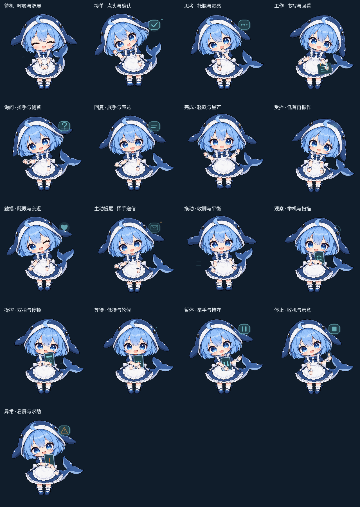

# 桌宠全状态动画 · preview.78

以现有鲸鱼娘形象为基础，覆盖当前原生桌宠的 17 类状态。动作保留角色轮廓与手腕绑定，采用骨骼姿态、眼睑表情、矢量道具及少量装饰组成；不会增加独立状态条或额外悬浮窗口。

“深海·专注”与“月汐·陪伴”的浅色、深色共四种配色共用动作，手写符号、纸张、气泡及手机屏幕跟随实际主题色。深海偏清楚克制，月汐通过配色延续柔和感，不添加新的设置项。

## 逐状态编排

| 状态 | 实际触发 | 姿态、表情与细节 |
| --- | --- | --- |
| 待机 IDLE | 没有更高优先级的活动 | 轻呼吸、错拍摆鳍、尾梢延迟；12 秒内有一次低频舒展和小水珠，平时保持安静 |
| 接单 ACCEPT | 任务接受回调 | 先微沉再抬身点头、单手致意，确认勾轻显再收回；1.7 秒内保留可读性 |
| 思考 THINK | 对话正在生成 | 侧首托腮、短暂半闭眼，思绪气泡三个点依次亮起；与后台工作明确区分 |
| 工作 WORK | 有运行中的后台任务 | 托板书写、笔尖摆动和笔迹伸展，间歇抬头回看，尾巴保持缓慢平衡 |
| 询问 ASK | 等待回答或任务询问 | 侧首、摊手、手腕微转，问号气泡轻浮，不反复跳跃催促 |
| 回复 REPLY | 收到对话回复 | 小幅点头、展手递出对话气泡，停留后收回；普通回复不再复用任务完成庆祝 |
| 完成 CELEBRATE | 后台任务完成 | 两次轻跃、双手抬起、短暂笑眼，五枚小星芒展开后消退 |
| 受挫 SETBACK | 任务失败或受阻 | 低首、短暂摇头、肩膀下沉，随后抬头恢复；云朵与细雨逐渐退场 |
| 触摸 TOUCH | 正常短按桌宠 | 身体亲近、单眼眨动、轻抬手与心形回应；1.05 秒收尾，与庆祝动作不同 |
| 主动提醒 NOTICE | 提示气泡实际显示成功 | 单手小幅挥动、递信图案与一点星光，3.4 秒收尾；排队但未显示的提示不触发 |
| 拖动 DRAG | 实际移动超过点击阈值 | 收脚、双鳍张开平衡，头发与尾巴反向跟随，短线随移动强度淡出；取消或松手即解除 |
| 观察 OBSERVE | 原生屏幕观察 | 抬手机、目光与手腕缓慢扫动，屏内放大镜和扫描线跟随节奏 |
| 操控 CONTROL | 原生输入执行 | 1.9 秒节拍包含两次短点按及停顿，手腕、屏内触点与小光点同步 |
| 等待 WAIT | 设备任务等候 | 手机略放低、身体轻呼吸，屏内三点与外围小轨迹表示等待 |
| 暂停 PAUSED | 用户暂停设备控制 | 立即切到暂停语义，举手持守、手机显示暂停，动作减至轻微呼吸 |
| 停止 STOPPED | 用户停止设备控制 | 收起手机、举手示意停止，方形符号保持清晰；不显示任务成功庆祝 |
| 异常 ERROR | 原生执行失败 | 短暂看屏摇头后保持求助姿态，琥珀色提示始终可辨，无闪烁警报 |

持续状态使用独立循环；瞬态动作自带预备、主体与退场。跨状态以约 260 ms 柔和融合，手机取出或收回约 420 ms。控制语义立即切换，不等待装饰动画播放完；视觉平滑不会延迟真实暂停、停止和取消。

## 接线及资源边界

真实设备状态优先于拖动、对话、后台任务及短时反应。拖动取消会清掉拖动状态，不能把桌宠留在腾空姿态。普通回复、任务完成、任务失败与主动提醒分别接到现有生产回调，没有为动画发起额外模型请求。

手机缩至原矢量尺寸的 88%，并略微下移，减少对脸部遮挡。装饰保持在原桌宠窗口内，绘制只复用画笔与路径，不生成逐帧位图、不增加常驻粒子列表、不扩大触摸区域。工作纸张、手机和装饰都使用当前主题颜色。

保留现有 20/30 Hz 动画预算及省电模式 12.5 Hz；隐藏、锁屏或息屏不继续排动画帧。减少动态效果时持续状态保留有意义的静态姿势和符号，不播放眨眼、循环及装饰过渡。已有任务接受、暂停、停止优先级与手势取消测试继续保留。

## 真机验收与预览

预览帧由 Pocket S 上的生产 `CompanionPetDrawable` 与 `PetActing` 原生渲染。它用于展示设计，不冒充 17 种业务事件均已发生；实际对话状态回调、真实触屏拖动及取消、控制状态抢占和减少动态效果另行断言。

Pocket S 已安装最终 `0.3.8-preview.78`（123）。安装包 `build/whale-assistant-0.3.8-preview.78.apk` 为 610,797,691 字节；SHA-256 `f07484240135305658c57b2416345b9db1755baf06b0fb4cabdcefce0a4e865c`，已与设备安装包核对一致。运行环境保持 `0.3.83-whale-screen-coordinates`。安装后启动界面显示“对话已就绪”和“本机服务正在运行”。结构化结果见[验收记录](桌宠全状态动画验收-20261106.json)。

| 验收 | 结果及范围 |
| --- | --- |
| 17 状态 × 4 配色 | 68 个原生展示组合生成并检查；手机不遮住眼睛，中文标签完整，托腮和触摸眨眼与其他动作可区分 |
| 真实悬浮窗事件 | 生产对话状态回调触发思考、回复及恢复；真触屏拖动、取消、暂停抢占、静态减少动态效果通过。测试直接调用对话状态回调，不把它当作真实模型会话 |
| 原生控制回归 | 两次真实点击、暂停、恢复、停止及延迟动作撤销通过；`p78-controls-device.log` |
| 关闭常驻桌宠及四主题静态状态 | 通过；常驻开关保持原值，暂停姿势和符号正确；最终包复测 `p78-reduced-delivery-device.log` |
| 绘制微基准 | 17 类状态，单次离屏绘制 P50 996 μs、P95 1,092 μs；不是整机帧率或整套 App 的耗时 |
| 可见 / 隐藏 | 各采样约 30 秒；可见进程 CPU 时间 2,954 ms，隐藏 14 ms；隐藏时不排动画帧。PSS 分别 100,301 / 100,342 KiB。仅为本轮短时应用进程采样，不代表整机耗电或长时间内存趋势 |
| 自动检查 | Android 1,871 项中 1,834 通过、37 跳过；脚本 493 项中 489 通过、4 跳过；零失败。前端基线 1,155 项、TypeScript、ESLint、四项门禁和最终构建通过 |

视觉检查后调整了托腮手位、书写笔的手腕绑定、手机尺寸和受挫表情。最后一次受挫调整只重新生成对应 80 帧及四套全状态图，其他预览帧保留同一原生渲染结果。所有测试均恢复主题、常驻开关、减少动态效果及桌宠位置；没有新增绘制以外的模型请求。

完整图册：[深海深色](images/p78-states-simple-dark.png)、[深海浅色](images/p78-states-simple-light.png)、[月汐深色](images/p78-states-cute-dark.png)、[月汐浅色](images/p78-states-cute-light.png)。

## 本地动画预览交付

Done: `build/鲸鱼助手-17种桌宠动画-preview78.mp4` — 84.00 秒，640×720，20 fps，H.264，1,680 帧，无音轨，12,329,185 字节。

Steps: Pocket S 生产绘制器导出各状态帧 → 按原生 50 ms 采样间隔编码；不增加插帧或改动角色源图。

Check: FFmpeg 技能探测和自定义规格检查完成，零失败；两项提示为无音轨及无独立字幕流。此片为安静的动画预览，状态标题已经直接画在画面中。

Look: `build/p78-animation-video-sheet.png` 已检查，角色完整、标题与脸部分离，手机与托腮手势清楚；联系图的时间码是检查工具附加，不在交付视频中。

Notes: 20 fps 是这份预览的采样与输出帧率，实际桌宠仍按原有 20/30 Hz 及省电策略调度。图册和视频展示动画设计；业务触发证据以表中的真实控制与生产回调测试为准。
