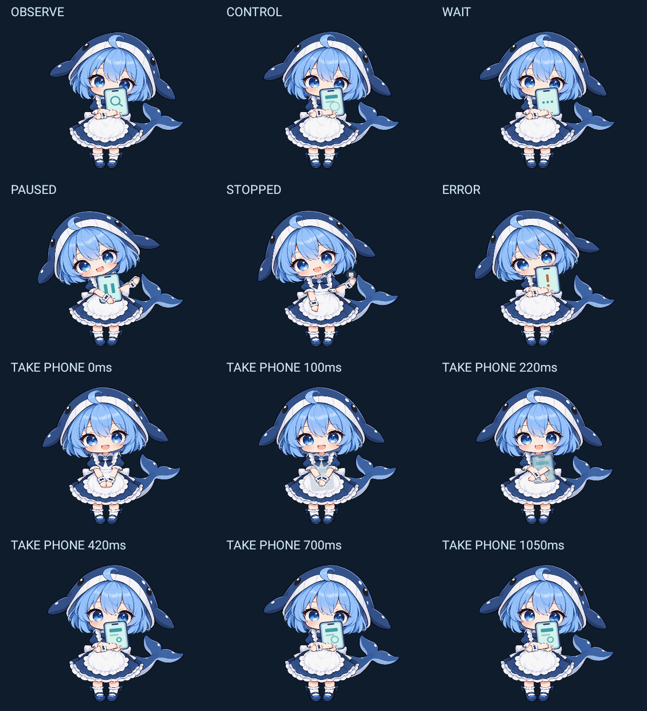

# 桌宠状态与主屏执行恢复

版本：0.3.8-preview.77 / 122，运行环境 0.3.83-whale-screen-coordinates。目标设备 AYANEO Pocket S。

## 交互与状态

独立状态条已删除。桌宠通过取出手机、持握、点按和抬手暂停表达控制状态；执行真相优先于接单、聊天和庆祝动作。暂停或停止不会被短暂点按动作的可读性停留时间延后。

控制菜单只在用户打开桌宠时出现。操控期间单击即可打开，暂停、恢复和停止具有文字及可访问描述。恢复只允许新的命令，旧步骤保持撤销。关闭常驻桌宠的用户在已有悬浮权限下临时看到桌宠，不会被改动常驻偏好。

原始角色图继续使用现有骨骼与网格，手机是绑定手腕的矢量道具。已查看 Pocket S 原生绘制的六状态与抬手过程图；这属于渲染检查，真实点击另行验证。减少动态效果仍显示手机或停止手势，不用中性站姿掩盖执行状态。

## 执行记录边界

原生设备桥是本阶段日志唯一写入者，guest 通过鉴权接口提交命令、读取恢复证据、确认收到回执。Android SQLite 事务包含操作记录与步骤记录，不声称与目标 App 的外部副作用具有原子性。

持久阶段依次为：运行意图 → dispatching → injected → observed → completed / stopped / unknown。进程代次变化将未收尾记录转为 unknown。同一编号的记录或墓碑阻止再次执行；输入回执和观察均不证明发送、支付或保存成功。

结果未知时，新的屏控工具调用被拒绝。恢复工具读当前前台应用与新画面，写入对账时间和摘要，状态仍保留 unknown，由上层据证据决定结束、重新规划或请求用户判断。预期应用不同则不完成对账。它没有自动从断点重放动作。

写入失败会在外部动作前终止；动作后连失败状态都写不进去时，内存保留待修复标记，后续入口先重试落盘，重启则从持久意图恢复为未知。旧执行代次不得覆盖新记录。

日志保留限制与范围见发布说明。资料库不做重复迁移；领域、工单、目标、主动事项和用户收件箱尚未形成统一事务，原始 Shell 与副屏尚不属于本阶段日志覆盖。

## 验收结果

设备序列号 `0031BRHA01029239`，保持 Whale 无障碍服务关闭，通过已授权 Shizuku 与本地 OCR 实测。

| 项目 | 结果与证据 |
| --- | --- |
| 真实观察、点击、暂停、恢复、停止 | 通过；`p77-pet-journal-device2.log`，两次真实点击，暂停及停止撤销后续延迟动作 |
| Clock 连续三页及异常目标 | 通过；`p77-journal-prepare-device.log`，三步 1,990 ms；失踪目标、错误前台、排队取消及执行中取消有回执 |
| 真实点击后回执写入失败，再杀 App 重启 | 通过；`p77-journal-before-restart2.log` 与 `p77-restart-motion-final.log`；副作用计数保持 1，对账后状态仍 unknown，旧操作不重放 |
| 关闭常驻桌宠时临时显示 | 通过；`p77-text-motion-device.log`；原开关不变，四套配色静态状态正确，真实触摸恢复后移除临时桌宠 |
| 手机道具、抬手及原有动作 | 原生绘制图已检查；13 种状态绘制通过；单次绘制 P50 1,401 μs、P95 1,822 μs，仅属绘制微基准 |
| Chrome 中文输入法下粘贴完整网址 | 通过；`p77-text-motion-device.log`；逐字核对真实地址栏，错误目标 App 被拒绝 |

增加画面稳定采样后的最终包复测：

| 项目 | 最终结果 |
| --- | --- |
| 写入意图失败，以及连 unknown 状态都写不进去 | `p77-journal-final.log` 通过；不准入新动作，恢复写入后仍要求对账 |
| 点击与后续观察 | `p77-latency-final.log` 通过；5 次 440–503 ms，中位数 454 ms，原生注入 2–5 ms；这是可见测试按钮的生产桥测量，不包含模型调用 |
| Clock 三步导航和取消 | `p77-sequence-final.log` 通过；三步 2,915 ms；上表 1,990 ms 来自增加稳定采样前，不能当作最终包成绩 |
| 三 App 真实启动及中文输入法原样粘贴 | `p77-text-final.log` 通过；错误前台拒绝 |
| 复杂任务最终产物 | 677 字节，原正文逐字节保留、追加两行唯一且准确；需要人工纠错和上下文压缩续接，最后使用原始 Shell 点击，完整自主及日志覆盖不通过 |

前端 93 个文件、1,155 项测试通过；脚本 493 项中 489 通过、4 跳过；Android 单测 1,869 项中 1,832 通过、37 跳过，零失败；TypeScript、ESLint、4 项门禁及构建通过。上述跳过项不计为通过。

最终 APK `build/whale-assistant-0.3.8-preview.77.apk`，1,030,596,780 字节，SHA-256 `853eeecace42d867bd6f8d99972ff5da5ce12928dab0a24ec2c1cdada43a80f5`，与 Pocket S 安装包逐字节哈希一致。本轮未向不可用的荣耀无线连接安装此包。

保留了中间失败：测试初版关闭 OCR 导致无观察租约，已纠正；临时桌宠恢复按钮首轮测试未通过；测试触摸改为明确触屏来源并裁剪至可见区域后复测通过，未单独隔离两项测试修正各自的影响。失败轮次不计为通过。

故障测试是在真实 SQLite 边界用触发器令回执提交失败，随后真的杀掉 App 再恢复。它不等同于整机断电、真实磁盘填满、精确时刻杀进程或整夜 Doze 测试。绘制耗时不等同于整机帧率、CPU 或耗电结论。三 App 完整任务另见复杂操控报告。
