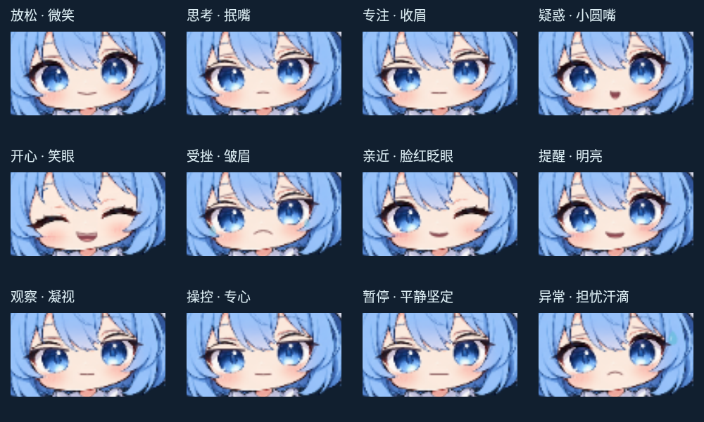
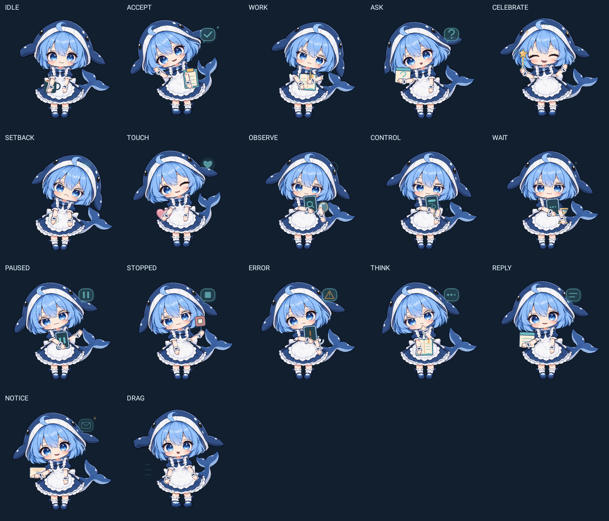

# 桌宠表情与手持道具 · preview.79

上一版主要改变骨骼姿态，原画的张嘴笑脸仍然覆盖大多数状态，头顶图案也不能代替手持道具。本轮将面部和手持物独立接入原生绘制与状态融合，保留原角色源图。

## 表情

嘴型、嘴角、眉形、眼睑、笑眼、脸红、泪滴及汗滴随状态变化。思考抿嘴、工作收眉、疑惑张小圆嘴、完成笑眼、受挫皱眉并恢复、触摸脸红眨眼、暂停保持平静、异常呈担忧表情。普通回复只做表达动作，不宣称音频口型同步。

上图使用同一身体和头部姿态，单独呈现脸部控制；是原生小尺寸渲染后的放大检查图。

## 道具

新增 15 类手持物：鲸鱼杯、任务夹板、书本、笔记本及笔、提问卡、回复卡、星星棒、纸巾、爱心抱枕、信封、放大镜、触控笔、沙漏、停止牌、扳手。观察、操控、等待、暂停及异常仍使用实际状态手机；拖动时腾出双手。

道具跟随手腕并位于手掌后。书写增加双手定位，让笔落在书页附近；放大镜、沙漏和扳手移到手机侧面；接单夹板改由另一只手拿，避免遮脸。切换道具淡出后再淡入，暂停仍立即切换控制语义。

Pocket S 的 88dp 为 264 像素。上图各角色按该尺寸原生绘制，网页或阅读器可能整体缩放图册。四配色图册：[深海深色](images/p79-states-simple-dark.png)、[深海浅色](images/p79-states-simple-light.png)、[月汐深色](images/p79-states-cute-dark.png)、[月汐浅色](images/p79-states-cute-light.png)。

## 验证

- Pocket S 安装 preview.79（124），运行环境保持 `0.3.83-whale-screen-coordinates`。安装包与设备 SHA-256 一致：`41e8e4290cd44b02774c808d0c1fb4279f3c3f599c307d73465f40740b0da1c1`，610,404,877 字节。
- 17 状态、四配色图册和 88dp 展示；固定身体姿态的像素检查证明开心 / 受挫、专注 / 放松确实改变脸部。生产对话回调、真实拖动取消、控制优先级及减少动态效果共三项测试通过。
- 原生屏控两次点击、暂停、恢复、停止；四主题静态状态与关闭常驻开关测试通过。
- 单次离屏绘制 P50 1.420 ms、P95 1.697 ms。可见 / 隐藏各约 30 秒，应用进程 CPU 时间分别为 3,607 / 16 ms，PSS 100,344 / 99,359 KiB；隐藏无动画排帧。相较上一轮单次绘制 P95 1.092 ms，本轮增加约 0.605 ms；不同采样不是严格性能对照，不代表整机帧率、耗电或长时内存趋势。
- Android 单元测试 1,872 项，1,835 通过、37 跳过、零失败；前端基线 1,155 项通过，脚本基线 489 通过、4 跳过，类型检查、ESLint、门禁和最终构建通过。

证据位于 `build/p79-face-props-device.log`、`p79-controls-device.log`、`p79-themes-reduced-device.log`、`p79-draw-device.log`、`p79-idle-cost-device.log`。测试恢复主题、桌宠开关、减少动态效果和位置。图册不是 17 种完整模型业务任务；本轮没有重新制作动画视频。
