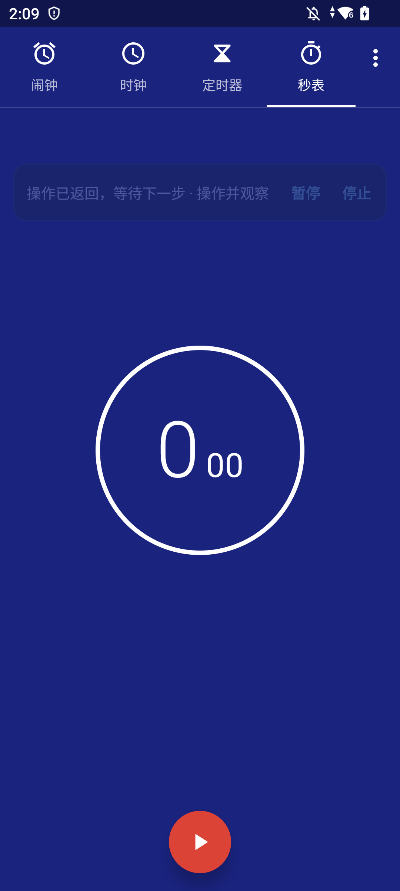

# 真实 App 多步屏控：Pocket S 实测

日期：2026-11-06。本轮从 preview.74 优化至 preview.75 / preview.76，测试对象是系统时钟和系统设置，使用手机已配置的真实云端模型、生产设备工具和 Shizuku 通道。没有用验收浮层代替真实 App，也没有更换模型、关闭评分或启用鲸鱼无障碍来规避实际条件。

## 测量方法

- Pocket S，序列号 `0031BRHA01029239`；默认横屏实际画面 2560×1440，密度 480，字体和系统动画比例均为 1。
- 每次创建独立真实会话。模型收到普通导航任务：时钟依次进入“时钟 → 定时器 → 秒表”；设置依次进入“网络和互联网 → 互联网”。不创建闹钟、不开始计时、不修改网络。
- 使用 `HarnessBubbleClient` 与正式设备工具发送任务。模型的工具调用与回合计时来自该回合流；页面到达由测试端独立读取真实 App 的选中标签 / 页面标题核实，测试端不执行被测步骤。
- 准备阶段只负责打开目标 App、返回时钟初始标签、取消首次通知弹窗。服务冷启动、会话创建及准备耗时单列在 instrumentation 总时长中，不计入表内任务耗时。动画开启，没有用关闭动画制造提速。
- “页面到达”从发出任务到独立观测到最终页；“整轮结束”还包含模型核验、最终回复和评分。主模型回合数不包含独立 reviewer 模型请求。页面观测轮询间隔约 35 ms，不能当作高精度输入时间戳。
- 基线运行环境为 `0.3.73-whale-screen-fast`。基线提示额外要求采用已有 observe / act 单步路径；新版不在用户提示里指定工具，由生产系统提示自动路由。主会话上下文、缓存和网络并非完全可控，所以报告样本及区间，不宣称普遍的 p95 或稳定提速比例。

## 基线：preview.74

| 时钟三步样本 | 最终页到达 | 整轮结束 | 主模型回合 |
| --- | ---: | ---: | ---: |
| 1 | 11.711 s | 16.525 s | 5 |
| 2 | 12.418 s | 81.322 s | 14 |
| 3 | 24.179 s | 84.778 s | 15 |

三次均按顺序到达秒表页且未启动秒表。较长样本不只是网络慢：安装的回答评分插件多次要求返工，产生额外观察与模型调用。不能只挑 16.525 秒作为全部基线，也不能把 81 秒全算成点击等待。

## preview.75：有限连续导航与收尾纠正

本版每步重新观察并精确定位，一次执行同一 App 的有限文字路径。前台应用查询改为常驻服务 Binder，避免 Shell 会话耗尽。OCR 使用实际空白间距拆分图标与文本，不删除猜测前缀。最终观察在本地比较文字稳定性；自有暂停 / 停止控制条按实际坐标排除，仍保持可见和可操作。

| 时钟三步样本 | 最终页到达 | 整轮结束 | 主模型回合 |
| --- | ---: | ---: | ---: |
| 1 | 3.890 s | 13.202 s | 3 |
| 2 | 4.236 s | 17.216 s | 4 |
| 3 | 3.955 s | 15.497 s | 3 |

这三次没有 reviewer 返工，模型仍单独补截图，因此 .75 已缩短动作间等待，但收尾仍有额外回合。设置修正准备流程后的一次样本在 12.154 秒到达、24.467 秒结束：OCR 将“互联网”识别为“互联朕网”，连续序列在第一步后正确停止，随后由模型重新观察并续接。

## preview.76：局部重识别与合并最终图像

- 文字疑似有一个字符误读时，只选择局部像素区域重识别；新的 OCR 仍必须精确匹配才可点击。不存在近似文字直接点击的路径。
- 当前路由支持图像且无原生控件树时，连续操作在同一受控执行中采集最终截图，与逐步回执一起交给模型，省去单独请求截图的规划回合。采集前后核实目标 App；新截图拥有最新观察编号，旧文字观察编号失效。
- 不支持图像时保留文字路径；附件失败保留已执行动作回执并注明错误，不重放。重要业务是否成功仍需核验，截图不是完成保证。

最终横屏样本均通过严格顺序和最终页面断言，只使用一次连续操作工具；没有重复切换标签。时钟第 1 次有一次评分反馈后改写回复，没有再次操作页面。

| 场景 / 样本 | 最终页到达 | 整轮结束 | 主模型回合 | 评分返工 |
| --- | ---: | ---: | ---: | ---: |
| 时钟三步 1 | 3.218 s | 12.837 s | 3 | 1 |
| 时钟三步 2 | 2.937 s | 8.136 s | 2 | 0 |
| 时钟三步 3 | 3.669 s | 14.829 s | 2 | 0 |
| 设置两级 1 | 5.080 s | 11.472 s | 2 | 0 |
| 设置两级 2 | 4.774 s | 11.191 s | 2 | 0 |
| 设置两级 3 | 4.007 s | 9.986 s | 2 | 0 |

时钟最终页到达中位数 **3.218 秒**，原基线为 12.418 秒，约缩短 74%；相邻页面切换间隔中位数 **352.5 ms**（234–475 ms）。整轮结束为 **8.136–14.829 秒**，中位数 12.837 秒。设置到达中位数 **4.774 秒**，相邻两级切换间隔中位数 614 ms；整轮结束为 **9.986–11.472 秒**，中位数 11.191 秒。设置没有同条件 .74 基线，因此不计算其新旧提速比例。

这些数据证明本地步骤间不再逐次等待模型。它们不能证明所有 App 都同样快，也不能说明最终回复已稳定压到数秒：主模型生成、图像核验和 reviewer 仍贡献收尾等待。主模型正常路径为两次调用，评分反馈会增加回合。

原生生产 HTTP 链路最终回归通过，覆盖三步完成、最终 JPEG 与新租约、控制条排除、秒表下指示线、目标缺失后不继续、错误 App 拒绝、取消先于排队，以及执行中取消 / 暂停。该项内部序列为 2.974 秒，不含后续截图编码和云端模型，不能与表内任务时间直接比较。

实际 1080×2400 竖屏下，控制条位置修正后，原生取消 / 暂停与两项真实模型测试全部通过：

| 竖屏场景 | 最终页到达 | 整轮结束 | 主模型回合 |
| --- | ---: | ---: | ---: |
| 时钟三步 | 4.158 s | 10.885 s | 2 |
| 设置两级 | 4.109 s | 12.786 s | 2 |

两项均只调用一次连续操作工具，没有评分返工或重复导航。已查看 1080×2400 实际截图：秒表标签下指示线可见，控制条位于标签下方，秒表未启动。测试后已恢复物理尺寸 1440×2560、自由旋转、默认固定旋转及原方向请求设置。

这组竖屏结果是单次验收，不能当成分位数统计。此前六个横屏样本使用同一执行与模型代码；最终 APK 仅进一步调整竖屏控制条位置及方向变化后的布局重算，横屏位置保持原策略。

## 保留的异常与迭代记录

1. 初期新增工具未被模型优先选择；调整生产提示的导航路由。保留 `p75-clock-first.json`（47.829 秒），不将其算作最终版收益。
2. 初版前台查询每步启动 Shell，触发会话上限；改为 Binder 查询。
3. 时钟图标与“定时器”被合并，导致精确目标缺失；以实际视觉间距分组，仍拒绝无证据的字符串删改。
4. 最终回看抓到转场内容，且 reviewer 把鲸鱼控制条当成秒表的“暂停 / 停止”；该次 62.376 秒长尾保留在 `p75-clock-final-1.json`。修复后 .75 三个样本无评分返工。
5. 时钟首次通知弹窗曾使准备失败；只通过返回取消弹窗，不授予或拒绝通知权限。设置准备曾过早发出返回，导致目标 App 离开前台；该次 45.379 秒记录保留为准备竞态样本，不能当作有效速度对照。修正为稳定确认设置首页后才开始计时。
6. 早期 .76 的时钟样本在 3.110 秒到达最终页，模型随后仍反复怀疑界面、额外切换定时器与秒表，整轮 112.511 秒，严格顺序断言失败（`p76-clock-2.json`）。该次不是评分器返工；补充实际像素指示线与只读核验约束后再验收。
7. 第一轮竖屏时钟因控制条遮住顶部标签，退回单步操作，17.299 秒到达、27.052 秒结束；顺序正确但快路径未生效。该记录保留，随后下移竖屏控制条并在横竖屏切换时重算布局。
8. .75 的设置路径仍会出现 OCR 误字和回合增多，是继续开发 .76 的直接原因，没有作为“所有 App 均已提速”的证据。

## 安装记录

用户在优化过程中要求先无线安装荣耀、再继续开发：已按该顺序，将荣耀 Magic6（BVL-AN00，`ANYX024823002463`）从 `.69 / 114` 保留数据升级至 `.75 / 120`，首次安装时间保持 `2026-10-30 17:26:54`。无线连接由当前 mDNS 发现并核对设备序列号。

荣耀本机 APK SHA-256 与 `.75` 交付包一致：`85bc2cf85fc36f0e1f0c4764b6211932758e9ae2cb22c747cdacd82b9fbc03e5`。运行环境已更新到 `0.3.76-whale-screen-sequence`，SHA-256 为 `c5239e4bc2d67590530c70b6569065f706fa90aef4b9af2961e8e2644ff7f5f0`；主应用、PRoot、Node 与设备服务已启动。荣耀此项是安装和启动检查，没有冒充完整功能验收；后续 `.76` 先在 Pocket S 实测。

架构层面的下一步见[连续、高效、主动、持久对照报告](SuperAgent架构缺口-连续高效主动持久-20261106.md)。

Pocket S 最终安装为 `.76 / 121`，配套运行环境 `0.3.79-whale-screen-evidence`，运行环境 SHA-256 `6fe31e26038eaaa19262ab3191bfdc665521791a3c5116f929708f5b03436481`。本机 APK 与交付文件 SHA-256 已核对一致：`dbed600faf962a3bf57e793b5437ff69e348f812d103cae5aacac5760ccda72f`。结束时重新打开主 App。

脱敏计时与调用事件见 [JSON 证据](PocketS-真实App多步屏控-20261106.json)，其中包含基线、最终样本与中间失败；不包含会话正文、截图图像数据、密钥或目标 App 的资料文本。
